# noonside

Monitoring for photovoltaic systems: a Go API and a React SPA, deployed with a Helm chart. It started as the replacement for a Solar-Log 1200 HTML export site. Accounts are created by invitation.

- **Systems and people:** multiple systems, inverters and module planes, with per-system roles (owner, admin, viewer), email invitations and superadmins. A system's address places it on a map and feeds the weather model.
- **Data in:** Solar-Log exports (hosted FTP on the installation's own SFTPGo, or your own FTP/FTPS/SFTP server; the full history via `noonside import solarlog`), devices pushing with API keys (e.g. SMA inverters over RS485 with [yasdi2solar0](https://github.com/chrishrb/yasdi2solar0)) and CSV imports of daily energy. Every reading passes plausibility checks; daily energy can be corrected by hand.
- **Yield:** day, month, year and total views per inverter or in total, compared with the previous year, the targets and the weather: the expected yield and performance ratio come from Open-Meteo irradiance on the module planes (PVGIS estimates for the targets). A calendar of daily yields, revenue, CO₂ avoided and CSV export.
- **Status and alerts:** live values per inverter, the event log, and alert rules (no data, inverter offline or in error, underperformance, a zero day, low yield against the weather, clipping, feed-in cap, implausible data, failing data source) checked every 5 minutes, with per-system thresholds.
- **Notifications:** an in-app inbox, email, Web Push, ntfy and signed webhooks, chosen per type: alerts, daily/weekly/monthly/yearly yield reports, and a morning forecast of the day's yield.
- **Prices and advice:** day-ahead prices (aWATTar or ENTSO-E), energy fed in at negative prices (§ 51 EEG), and the best window today for large loads. noonside gives advice and signals; it never switches devices.
- **Integrations:** signed webhooks per system (alerts, daily summary, surplus forecast) for Home Assistant, Node-RED or n8n, a read API for Home Assistant or Grafana, and upload to PVOutput.
- **Sharing:** read-only public links to a system, with a kiosk mode for large screens.
- **App:** English and German, light and dark, installable as a PWA with push on phones. Accounts, sign-in and password reset are handled by a self-hosted GoTrue (Supabase Auth); errors and "Report a problem" go to Sentry.

## Product tour

Screenshots from a local stack with demo data (`mise run docs:screens`). The app is available in English and German, and in light and dark mode.

<table>
<tr>
<td colspan="2" valign="top">
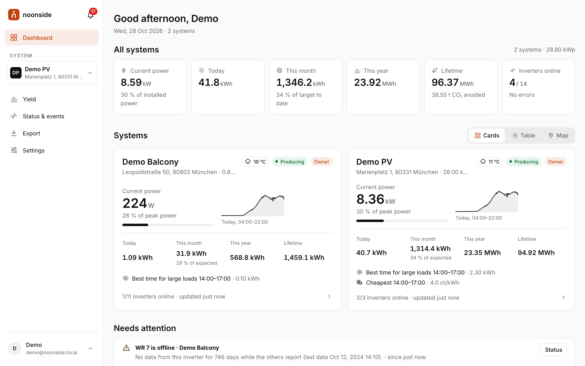<br/>
<sub><b>Dashboard</b>: current power, today, month, year and lifetime across all your systems, a card per system with weather, its intraday curve and the cheapest hours, and anything that needs attention. Also as a table or a map.</sub>
</td>
</tr>
<tr>
<td width="50%" valign="top">
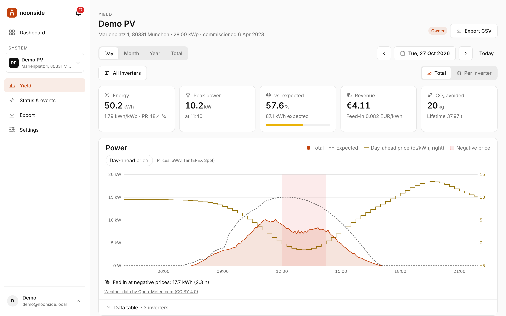<br/>
<sub><b>Yield: day</b>: 5-minute power curve per inverter or in total against the weather-based expectation and the day-ahead price, with energy, peak power, performance ratio, revenue and CO₂ avoided.</sub>
</td>
<td width="50%" valign="top">
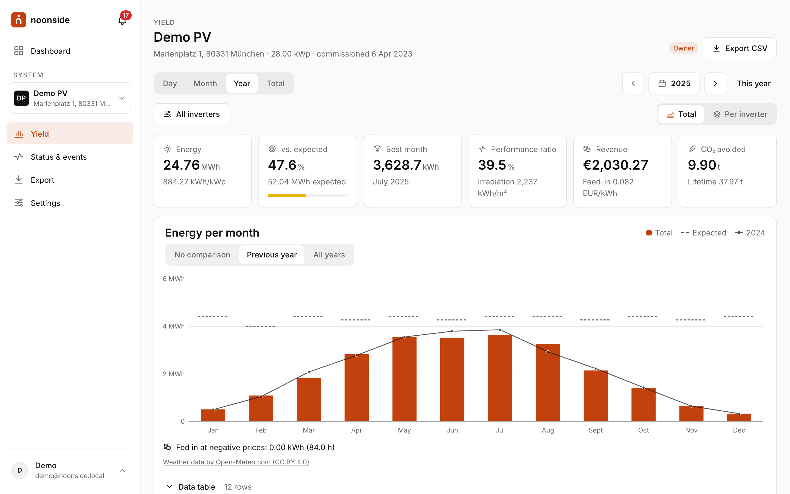<br/>
<sub><b>Yield: month and year</b>: energy per day or month against the expectation and the previous year (or all years), with a data table and CSV export.</sub>
</td>
</tr>
<tr>
<td width="50%" valign="top">
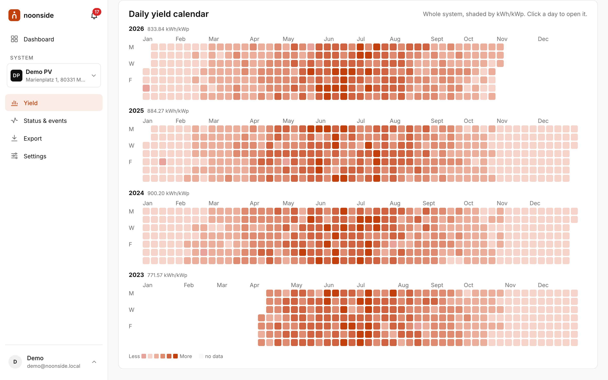<br/>
<sub><b>Yield: total</b>: energy per year and a calendar of every day since commissioning, shaded by kWh/kWp; a click opens the day.</sub>
</td>
<td width="50%" valign="top">
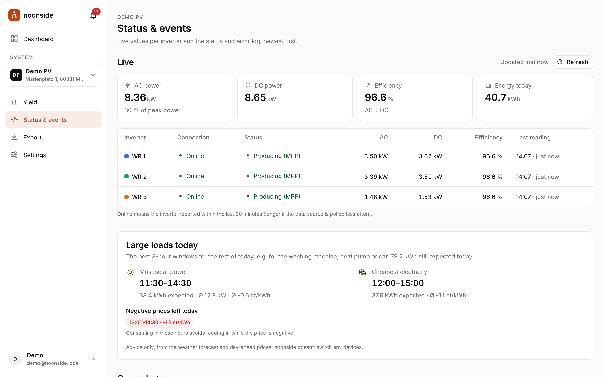<br/>
<sub><b>Status &amp; events</b>: live AC/DC power and efficiency per inverter, the best windows today for large loads (most solar power, cheapest electricity, negative prices), open alerts and the event log.</sub>
</td>
</tr>
<tr>
<td width="50%" valign="top">
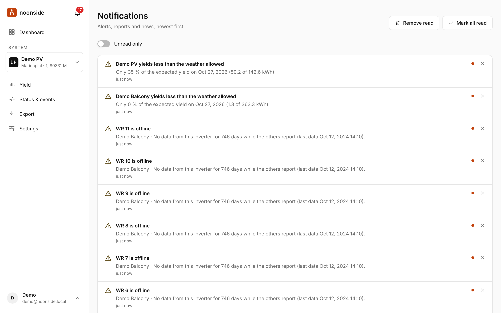<br/>
<sub><b>Notifications</b>: alerts, reports and the morning forecast in the inbox, and by email, push, ntfy or webhook as each member chooses.</sub>
</td>
<td width="50%" valign="top">
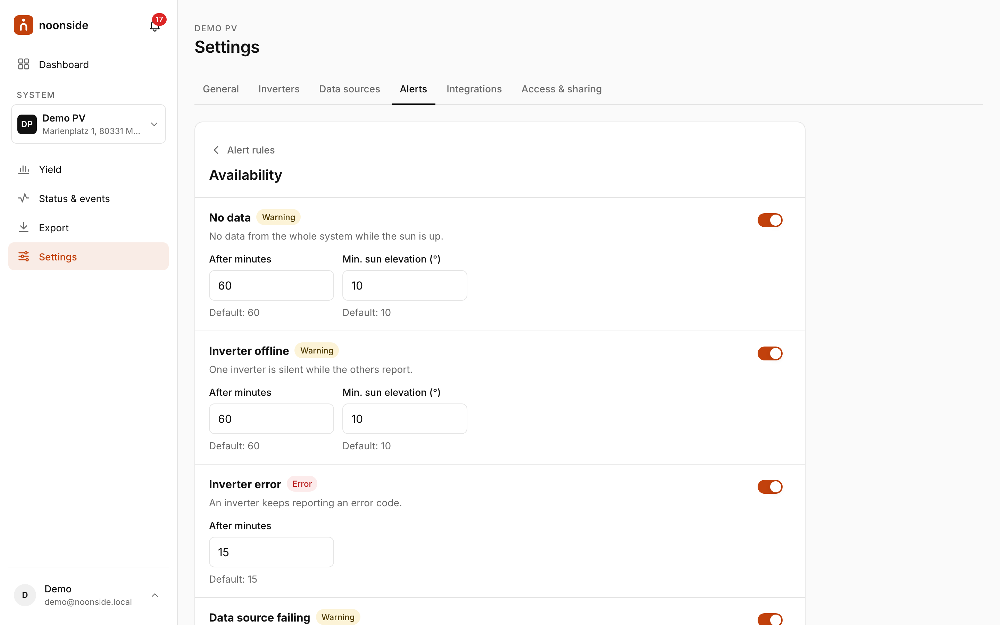<br/>
<sub><b>Alert rules</b>: availability, yield, limits and data quality, each with its own thresholds per system.</sub>
</td>
</tr>
<tr>
<td width="50%" valign="top">
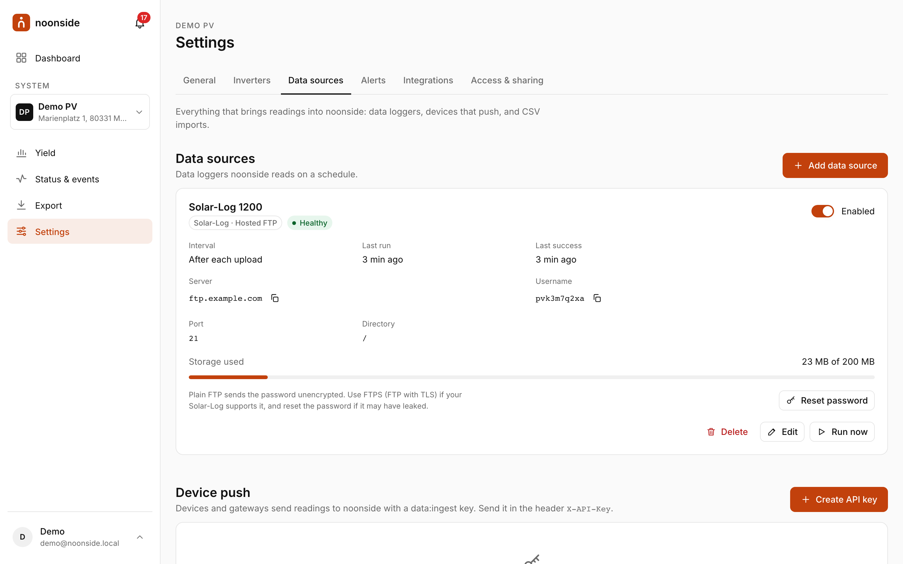<br/>
<sub><b>Data sources</b>: a Solar-Log uploading to an FTP account noonside provides, or pulled from your own server over FTP, FTPS or SFTP; devices push with API keys, and daily energy is imported from CSV.</sub>
</td>
<td width="50%" valign="top">
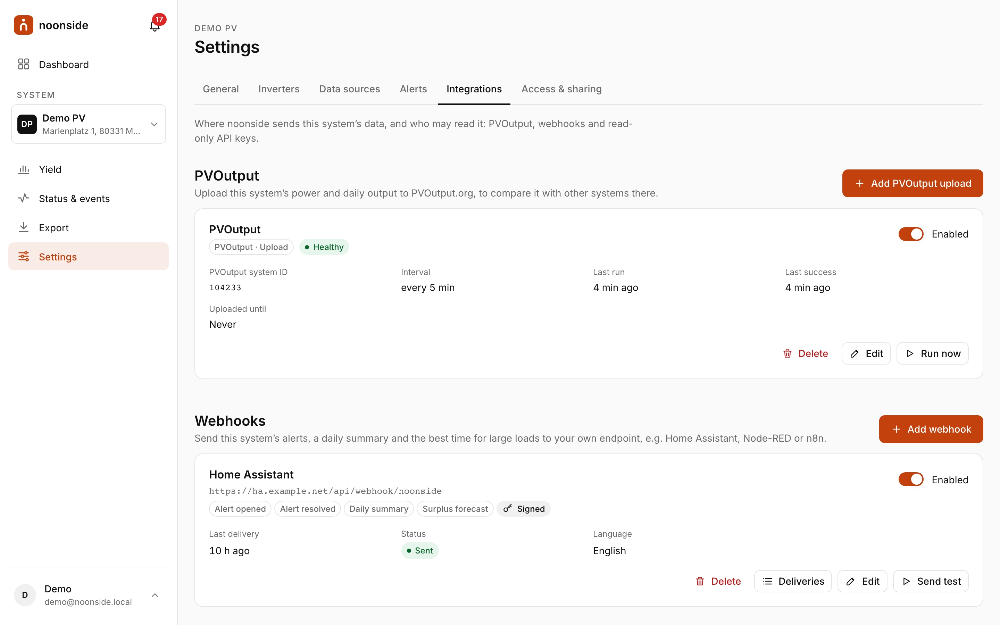<br/>
<sub><b>Integrations</b>: upload to PVOutput, signed webhooks for Home Assistant and friends, and read-only API keys.</sub>
</td>
</tr>
<tr>
<td width="50%" valign="top">
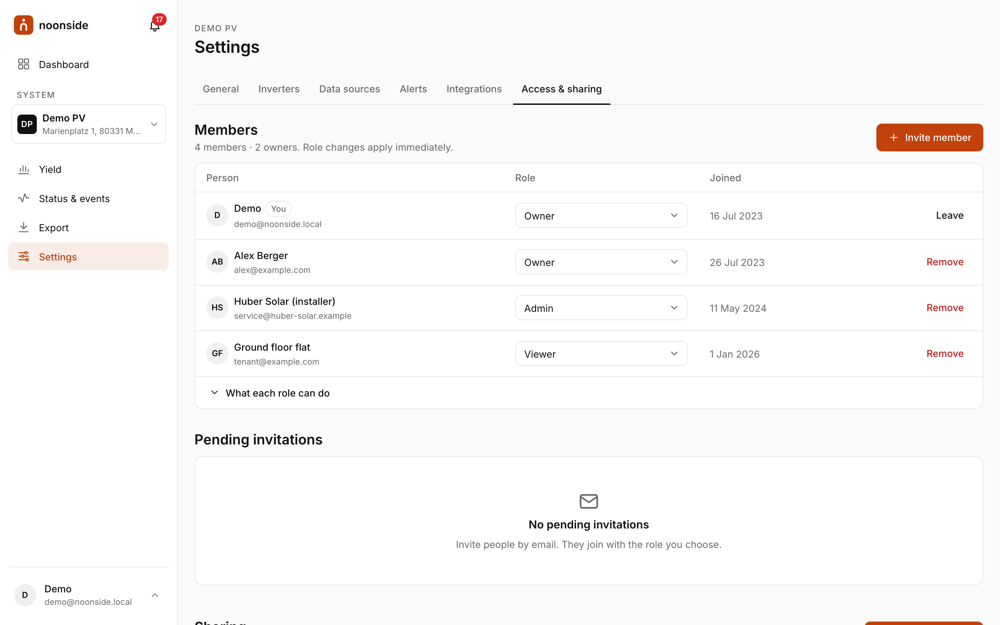<br/>
<sub><b>Access &amp; sharing</b>: owner, admin and viewer roles per system, invitations by email, and public share links.</sub>
</td>
<td width="50%" valign="top">
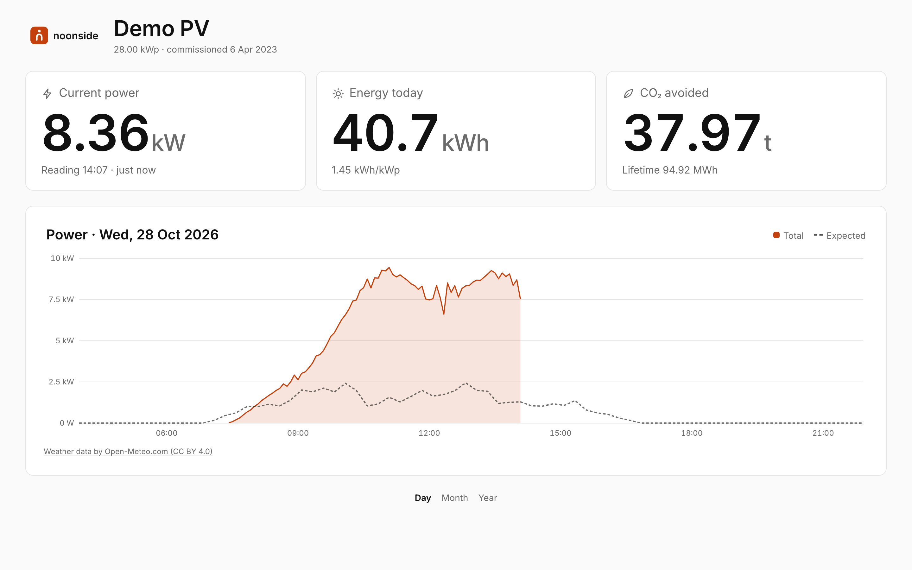<br/>
<sub><b>Kiosk</b>: a share link with <code>?kiosk=1</code> for a screen in the hallway or the shop window, without an account.</sub>
</td>
</tr>
<tr>
<td width="50%" valign="top" align="center">
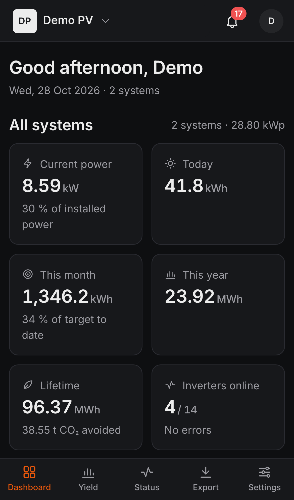<br/>
<sub><b>Mobile</b>: installable as a PWA, with a bottom tab bar, push notifications and dark mode.</sub>
</td>
<td width="50%" valign="top" align="center">
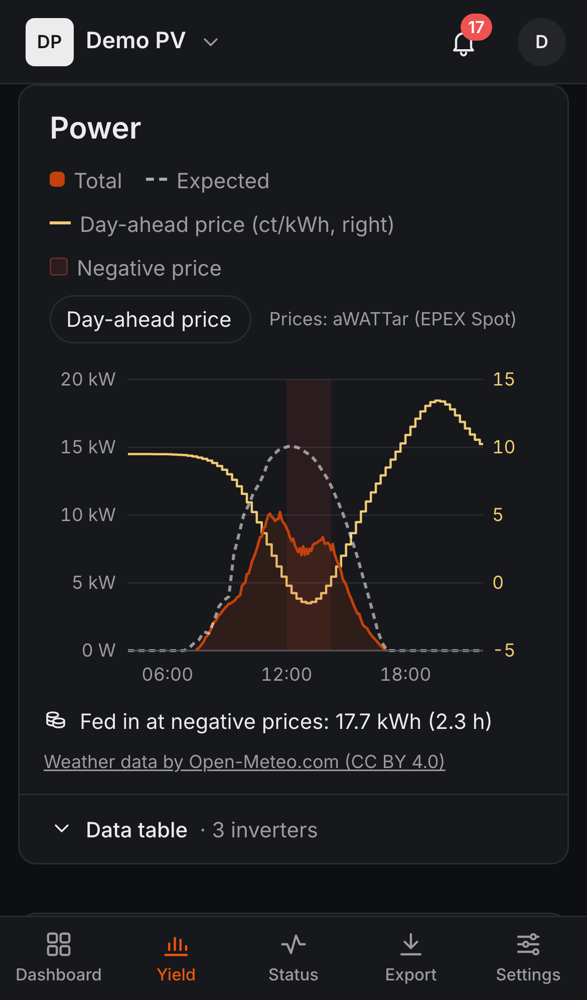<br/>
<sub><b>Charts on the phone</b>: the same views, sized for a small screen.</sub>
</td>
</tr>
</table>

## Architecture

| Part | Tech |
|---|---|
| API | Go, stdlib `net/http`, spec-first with [ogen](https://github.com/ogen-go/ogen) (`backend/internal/platform/httpapi/api.yaml`) |
| Database | Postgres 17 (CloudNativePG in production), pgx with hand-written SQL, migrations in `backend/db/migrations/` (`noonside migrate`) |
| Auth | GoTrue (Supabase Auth, self-hosted) under `/auth/v1` of the app's origin. The SPA signs in with supabase-js, and the API verifies the access token (JWKS). |
| Web | React 19, Vite, TypeScript, TanStack Query, Tailwind v4 (`web/`) |
| Email | go-mail + `html/template` (also renders GoTrue's email templates) |
| Errors | Sentry (optional) in the API and the SPA |
| Hosted FTP | [SFTPGo](https://github.com/drakkan/sftpgo) (optional), driven by the API over its REST API |
| External data | Open-Meteo (weather), PVGIS (target estimates), Photon (geocoding), OSM tiles (maps), aWATTar or ENTSO-E (day-ahead prices) |

The backend is a modular monolith: each module in `backend/internal/modules/` owns its tables, API operations and scheduler jobs, and `backend/internal/archtest` enforces the boundaries.

The API server serves `/api/v1`, `/openapi.yaml`, `/healthz`, `/readyz` and `/media/`. The web app is a separate image (nginx with the static build); a gateway puts both, and GoTrue under `/auth/v1`, behind one origin.

## Development

Needs [mise](https://mise.jdx.dev/) (installs Go, Node, pnpm, golangci-lint and helm from `mise.toml`) and Docker for the local stack in `compose.yaml`: Postgres (:54322), GoTrue (:9999), Mailpit (:54324) and SFTPGo (hosted FTP), the same pieces as in the chart.

The repository root holds `backend/` (Go API and CLI; `backend/db/`: migrations, seed, auth email templates), `web/` (React SPA), `deploy/` (Helm chart, Postgres bootstrap), `landing/` (static landing site with a waitlist) and `docs/` (screenshots). The mise tasks run from the root.

```sh
mise install
mise run web:install
mise run dev:stack                  # compose stack + migrations, API on :8080 (reloads on Go changes), SPA on :5173
```

Open http://localhost:5173 and sign in with one of the local accounts. `mise run db:reset` creates them (it re-creates the database, migrates and runs `backend/db/seed.sql`); `mise run dev:seed` restores them without a reset. They exist only in the local database; production never gets the seed.

| Account | Password | What it sees |
|---|---|---|
| `dev@noonside.local` | `noonside-dev-pw` | Superadmin: every system and the admin pages |
| `demo@noonside.local` | `noonside-dev-pw` | Owner of "Demo PV" (3 inverters, years of data, an open alert) and "Demo Balcony" only; used by the Playwright checks |
| `demo-de@noonside.local` | `noonside-dev-pw` | The same in German |
| `admin@noonside.local` | `noonside-dev-pw` | Admin of "Demo PV" |
| `viewer@noonside.local` | `noonside-dev-pw` | Viewer of "Demo PV" |

In development the sign-in page lists these accounts; one click signs in.

"Demo PV" is also shared publicly at http://localhost:5173/p/s0p_local-dev-demo-link (add `?kiosk=1` for kiosk mode). Other accounts: `noonside user create you@example.com [--superadmin]`. Auth emails (password reset) land in Mailpit on http://localhost:54324.

Without `dev:stack`: `mise run db:up`, then `mise run dev` (API) and `mise run web:dev` (SPA) in two terminals. Vite proxies `/api` and `/media` to the API and `/auth/v1` to GoTrue, like the gateway in production.

`docker compose --profile docs up -d swagger-ui` shows the API docs on http://localhost:8081.

Common tasks (`mise tasks` lists all):

```sh
mise run generate          # after editing api.yaml: Go server + web client in web/src/api/gen
mise run test              # Go unit tests
mise run test:integration  # API tests against the compose stack (migrates first)
mise run lint              # golangci-lint
mise run lint:actions      # actionlint on .github/
mise run web:test          # vitest
mise run web:lint          # tsc + eslint
mise run web:e2e           # Playwright: smoke test + layout checks on desktop, tablet, phone (running stack)
mise run web:shots         # layout checks with screenshots in web/e2e/screenshots/
mise run docs:screens      # the README screenshots in docs/screenshots/ (re-seeds the dev data)
mise run db:reset          # wipe the local DB: migrations + seed
mise run db:migration:new NAME  # new backend/db/migrations/<timestamp>_NAME.sql
mise run chart:lint        # helm lint + kubeconform of deploy/helm/noonside
```

Import an existing Solar-Log export:

```sh
mise run build
backend/bin/noonside import solarlog DIR --system ID
```

## Configuration

Settings come from `backend/config/default_config.yml`, merged with `backend/config/<ENVIRONMENT>_config.yml`. Environment variables override both, e.g. `HTTP_PORT`, `PUBLIC_URL`, `SUPABASE_URL`, `CORS_ALLOWED_ORIGINS`, `SCHEDULER_ENABLED`, `SMTP_HOST`, `MAIL_FROM`. `prod_config.yml` only holds generic production defaults; everything specific to an installation comes from the Helm values.

Secrets are only read from the environment:

| Variable | Purpose |
|---|---|
| `DATABASE_URL` | Postgres, as URL or `key=value` string; libpq variables (`PGUSER`, `PGPASSWORD`, …) fill in the rest. |
| `SUPABASE_SECRET_KEY` | GoTrue's service_role key for its admin API (user creation, superadmin flag); `noonside keygen gotrue` |
| `SUPABASE_JWT_SECRET` | Optional, for legacy HS256 tokens |
| `SECRET_KEY` | Encrypts data source passwords at rest (`noonside keygen`) |
| `SMTP_PASSWORD` | Outgoing email |
| `VAPID_PRIVATE_KEY` | Optional. Signs Web Push notifications; the public key is `vapid_public_key` (`noonside keygen vapid`). Without it push is off. |
| `SFTPGO_ADMIN_PASSWORD` | Optional. SFTPGo's admin password; with `hosted_ftp_api_url` it turns on hosted FTP (see below). |
| `ENTSOE_API_TOKEN`, `OPEN_METEO_API_KEY` | Optional. Day-ahead prices from ENTSO-E; Open-Meteo's commercial API. |

The server reaches GoTrue at `supabase_internal_url` (in the cluster `http://<release>-noonside-auth:9999`), else at `<supabase_url>/auth/v1`; tokens are issued for `<supabase_url>/auth/v1`.

## Deployment

The Helm chart in `deploy/helm/noonside` installs everything on Kubernetes:

```
Gateway (Gateway API HTTPRoute)  noonside.example.com
   ├─ /auth/v1/* ─ prefix stripped ─→ <release>-auth   (GoTrue)
   ├─ /api, /media, /healthz, …    ─→ <release>-api    (API, scheduler)
   └─ /*                           ─→ <release>-web    (nginx with the web app)
<release>-pg:     CloudNativePG cluster (Postgres 17), optional backups to S3 (barman-cloud)
<release>-sftpgo: optional hosted FTP for the loggers (LoadBalancer Service: FTP + passive ports)
```

- **The chart:**
  - The API runs as one replica with the Recreate strategy. Its pictures live on a ReadWriteOnce volume, and an init container runs `noonside migrate --wait` before the server starts.
  - The web app is stateless (`web.replicas`). Its CSP and the runtime config (`/config.js`: Sentry DSN, environment, sample rates) come from the container's env (`web/nginx`), so the same image runs everywhere.
  - GoTrue fetches its email templates from the API's Service; `/auth-templates` isn't routed publicly.
  - A CNPG `Cluster` is bootstrapped with `deploy/helm/noonside/files/init.sql` (roles, schemas and extensions that GoTrue and the migrations expect; compose uses the same file). The cluster and the volumes survive `helm uninstall`.
  - All values, with comments: `deploy/helm/noonside/values.yaml`. `ci/test-values.yaml` switches everything on.
- **Values you set** (non-secret, e.g. in a Flux HelmRelease): `host`, `smtp.*`, `vapidPublicKey`, `route.parentRefs`, optionally `landingUrl`, `sentry.*`, `postgres.backup.*`, `hostedFtp.*`.
- **Secrets the chart expects** (create them yourself, e.g. with external-secrets):
  - `api.existingSecret` (default `noonside-secret`): `SECRET_KEY`, `SMTP_PASSWORD`, `VAPID_PRIVATE_KEY`, `SUPABASE_SECRET_KEY`, optional tokens.
  - `auth.existingSecret` (default `noonside-auth`): `GOTRUE_JWT_KEYS`, `GOTRUE_JWT_SECRET` (`noonside keygen gotrue`), `GOTRUE_SMTP_PASS`.
  - `postgres.authRoleSecret` (default `noonside-pg-auth`): basic-auth secret of `supabase_auth_admin`.
  - With backups: `postgres.backup.s3.credentials.existingSecret` (access key, optional region).
  - With hosted FTP: `hostedFtp.admin.existingSecret` (`SFTPGO_ADMIN_PASSWORD`), optional TLS and host key secrets.
- **Database access:** the API and the migrations connect as the superuser (`PGUSER`/`PGPASSWORD` from CNPG's secret), GoTrue as `supabase_auth_admin`.
- **Sentry** (`sentry.enabled`, `sentry.api.dsn`, `sentry.web.dsn`, sample rates, environment): off by default. The web app's events go through the API's tunnel (`/api/v1/diag`), so the CSP needs no Sentry host.
- **Backups** (`postgres.backup.enabled`): WAL archiving (`walArchiving`) and scheduled base backups (`schedule`, empty for none) to `s3.destinationPath`, any S3-compatible store via `s3.endpointURL`, with `retentionPolicy`. Needs the barman-cloud plugin.
- **Rate limits:**
  - Per IP, in the API (`internal/router/ratelimit.go`): `/api/*` and stricter on the public endpoints.
  - In GoTrue (`GOTRUE_RATE_LIMIT_*`, `auth.rateLimits`).
  - The client address is the gateway's `X-Forwarded-For` entry (`trustedProxyHops`).

### Deploying

`.github/workflows/deploy.yml` runs after CI succeeds on `main`, or manually. It needs no cluster or cloud credentials:

1. **image:**
   - Builds the web app once with source maps (`--target web-dist`); with `SENTRY_ORG` set, `mise run web:sourcemaps` uploads them to Sentry.
   - Builds and pushes `ghcr.io/<owner>/noonside-api:<commit>` and `noonside-web:<commit>` for amd64 and arm64.
2. **chart:** lints the chart and pushes it as version `0.1.<run>` (appVersion = commit) to `oci://ghcr.io/<owner>/charts`.
3. **GitOps:** e.g. a Flux `OCIRepository` (`>=0.1.0`) picks up the new version and upgrades the release.
4. **smoke** (only with the repository variable `PUBLIC_URL`): waits until `/healthz` reports the commit (`Noonside-Release` header), then checks `/readyz`, the web app, a 401 from `/api/v1/me` and GoTrue's `/auth/v1/health`.

Watching a rollout: `kubectl -n noonside logs deploy/<release>-api -c migrate`, `kubectl -n noonside logs deploy/<release>-api -f`.

**First user:** `kubectl -n noonside exec deploy/<release>-api -- /app user create you@example.com --superadmin` (the password comes from the prompt).

### Hosted FTP

Many Solar-Logs can only push their export over FTP. With hosted FTP (`hostedFtp.enabled`), the installation provides the server, an [SFTPGo](https://github.com/drakkan/sftpgo): adding a "Solar-Log · Hosted FTP" source creates an SFTPGo account through its REST API and shows the password once. The user enters host, user and password in the Solar-Log's FTP export.

- **Event-driven:** an SFTPGo event rule, which the API sets up itself, posts every upload to `POST /api/v1/hooks/hosted-ftp` (authenticated with a token derived from `SECRET_KEY`; the SFTPGo URL, admin user and hook URL are set by the chart). The source is imported once its uploads have been quiet for 30 s, reading the files over SFTP in the cluster. Hosted sources aren't polled; "Run now" still works.
- **Isolation:** one account per data source with its own home directory; only FTP/FTPS (and SFTP) are allowed. Its password is generated, sealed with `SECRET_KEY` and can only be reset, not shown again. Deleting the source, or its system, deletes the account and its files. An hourly job removes accounts left behind.
- **Limits** (`hostedFtp.*`, `hosted_ftp_*` in `backend/config/default_config.yml`):
  - at most one hosted source per system, and `maxAccounts` in total (0: unlimited);
  - SFTPGo enforces the quota (`quotaMB`) per account; from 90 % of it the run fails, which raises the `data_source_failing` alert;
  - imported minute files are deleted after `retentionDays`, files that aren't Solar-Log exports after a day, and files above 20 MB right away.
- **Network:** FTP needs the control port and the passive range (`hostedFtp.ftp.passivePorts`) reachable from outside, e.g. a LoadBalancer with `forcePassiveIP`. Plain FTP sends the password unencrypted; with `hostedFtp.ftp.tls.secretName` SFTPGo also offers explicit FTPS.
- Locally, `compose.yaml` runs SFTPGo; the integration tests use it.

**Limitation:** "Run now" on a data source (`POST .../data-sources/{id}/run`) runs synchronously while the browser waits. For a long first-time backfill, use `noonside import solarlog` or let the scheduler do it; ingest is idempotent.

### Error reporting

[Sentry](https://sentry.io) collects errors from the API and the SPA, and the SPA's "Report a problem" form (account menu, and on the error page), when the chart's `sentry.*` values are set.

- **API** (`backend/internal/platform/errtrack`): every log record at level `Error` becomes an event, with the request's operation, user ID and trace. So expected failures that users fix themselves (an unreachable data source, a wrong password) are logged at `Warn`. Panics in requests, scheduler jobs and data source polls are recovered, reported and answered with a 500. Traces: `sentry_traces_sample_rate` (default 10 %), continued from the SPA, with a span per database query (`db/trace.go`) and per outgoing HTTP request (host only). Scheduler jobs and data source runs are transactions of their own (`sentry_job_traces_sample_rate`, default 1 %).
- **SPA** (`web/src/lib/sentry.ts`, configured at runtime by `/config.js`): uncaught errors, route errors and errors in query functions; API errors only come from the API. Replays only of the minute before an error or a report, with all text, inputs and images masked, and none on pages opened with a token (share links, invitations, password reset). The replay and feedback code loads after the first render.
- **Privacy:** only the user ID, never the email or name. Credentials headers, cookies, bodies, query strings, URL fragments and the tokens in share and invitation links are removed before sending. The privacy policy (`landing/src/pages/datenschutz.astro`) names Sentry as a processor.
- The DSNs are not secret. Without them (local development, tests) Sentry is off. To try it locally, set `SENTRY_DSN` and `SENTRY_WEB_DSN` for the API and `VITE_SENTRY_DSN` for Vite to a test project's DSNs.

### Docker

There are two images: `backend/Dockerfile` (built from `backend/`; distroless: the binary, the migrations in `/migrations` and GoTrue's email templates in `/auth-templates`; `serve` also runs the scheduler) and `web/Dockerfile` (built from `web/`; nginx with the web app, `web/nginx`). `mise run docker:build` builds `noonside-api:dev` and `noonside-web:dev`. Running them needs Postgres, set up with `deploy/helm/noonside/files/init.sql`, and GoTrue (see `compose.yaml` or the chart):

```sh
docker run --rm -e DATABASE_URL=… noonside-api:dev migrate --wait 5m
docker run -p 8080:8080 -e DATABASE_URL=… -e SUPABASE_URL=https://<host> -e SUPABASE_INTERNAL_URL=http://<gotrue>:9999 \
  -e SUPABASE_SECRET_KEY=… -v noonside-media:/data/media noonside-api:dev
docker run -p 8081:8080 -e SENTRY_DSN=… noonside-web:dev
```

The SPA expects the API under `/api` and GoTrue under `/auth/v1` of its own origin, so put all three behind one reverse proxy.

## CI

`.github/workflows/ci.yml` runs on pushes to `main` and on pull requests:

- **go:** `mise run lint`, `mise run test` and `mise run generate:check` (fails if `backend/internal/platform/httpapi/generated` or `web/src/api/gen` is out of date)
- **integration:** `docker compose up -d --wait` (the tests compile meanwhile), then `mise run test:integration`
- **web:** typecheck, lint, unit tests and build
- **landing:** typecheck and build of the landing site
- **chart:** `mise run chart:lint` (helm lint, kubeconform)
- **actions:** `mise run lint:actions` (actionlint)

Each job only runs when its files changed, and Dependabot's minor and patch updates are merged once they pass.

`.github/workflows/deploy.yml` publishes `main` to GHCR after CI passes (see Deployment).

## License

[GNU Affero General Public License v3.0](LICENSE). If you run a modified noonside as a service, you must make your changes available to its users.
